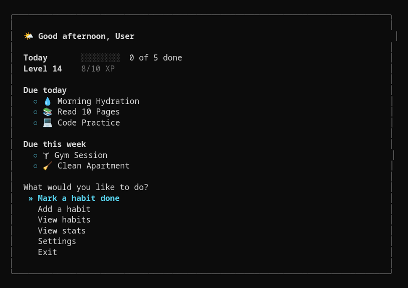

# Python Habit Tracker

[](https://github.com/RafyTime/python-habit-tracker/actions/workflows/ci.yml)
[](https://coverage-badge.samuelcolvin.workers.dev/redirect/RafyTime/python-habit-tracker)

Track daily and weekly habits, review streaks, and earn XP from the terminal.
This Python and Typer app is my portfolio project for IU's **Object-Oriented and Functional Programming with Python** course.

[Set up the tracker](#quick-start) or [explore four weeks of sample data](#evaluate-with-sample-data).

## Quick start

You'll need Git, Python 3.14 or later, and [uv](https://docs.astral.sh/uv/).

```bash
git clone https://github.com/RafyTime/python-habit-tracker.git
cd python-habit-tracker
uv sync
uv run habit today
```

A fresh tracker shows “No habits yet.” Add a daily habit, record a completion,
and check its stats:

```bash
uv run habit add "Read 10 pages" --every daily
uv run habit done "Read 10 pages"
uv run habit stats "Read 10 pages"
```

The completion earns 1 XP. The stats show one completion and a longest streak
of one day.

## Evaluate with sample data

From the project directory, seed an empty tracker to explore five daily and
weekly habits with four weeks of completions and XP history:

```bash
uv run habit seed
uv run habit
```

The second command opens the interactive home in a terminal. Choose **View
stats** to explore the seeded history. If you already have habits, the seed
command asks before mixing in sample data. The
[user guide](docs/USER_GUIDE.md#sample-data) explains how to use a separate database.



The screenshot uses sample data seeded one week earlier so the habits are due again.

## Explore and verify the project

- [User guide](docs/USER_GUIDE.md) covers everyday commands, settings, and troubleshooting. Run `uv run habit --help` for the command list.
- [`src/main.py`](src/main.py) registers the commands for the installed `habit` CLI.
- [`src/core/`](src/core/) contains habit tracking, analytics, and XP logic.
- [Phase 2 development notes](docs/phase_2/DEVELOPMENT_PHASE.md) describe how the project evolved.

Run the local quality checks for formatting, linting, types, tests, and coverage:

```bash
uv run scripts/quality.py
```
